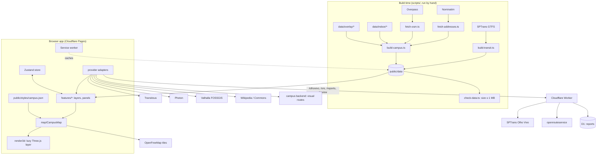

# Architecture

A static Vite + React + TypeScript PWA on Cloudflare Pages, plus one Cloudflare Worker. MapLibre draws an OpenFreeMap basemap from `public/styles/campus.json`. Campus buildings, POIs, accessibility features, bus stops, line shapes, trees, roofs and floor plans are generated by scripts and committed in `public/data/`. Live data (bus arrivals and positions, step-free routes, user reports) goes through the Worker; Transitous, Valhalla, Photon and Wikipedia are called straight from the browser. One lazy-loaded Three.js layer draws trees, roofs and 3D buses. The UI is pt-BR only.

## Stack

Vite, React, TypeScript (strict, `noUncheckedIndexedAccess`), MapLibre GL JS through `@vis.gl/react-maplibre`, Three.js, Zustand (UI state, `src/state/store.ts`), TanStack Query (polling and caching), MiniSearch (offline search), `vite-plugin-pwa`, Vitest. Worker: Wrangler, Cloudflare D1 with Drizzle ORM. Build scripts run with `tsx`. One `package.json`, npm.

## Data flow

## Code rules

- Feature folders: `src/features/<area>` owns its sources, layers, panels and providers. `src/map/` composes, `src/ui/` holds shared pieces, `src/render3d/` the Three.js layer, `src/domain/` the types and pure logic.
- Soft cap of about 300 lines per file; split by responsibility past that.
- `src/map/CampusMap.tsx` only mounts `<Map>` and each feature's layers.
- Components never read raw API payloads or raw GeoJSON properties, only domain types from `parse.ts` or a provider.
- Every user-facing string is in `src/strings/pt-BR.ts`.
- App layers are inserted before one of the anchor layers (`src/map/anchors.ts`), never before a basemap layer id. See [basemap.md](basemap.md).
- Credentials never go into source code, the bundle or logs.

## Provider adapters

Built on `src/lib/http.ts` (`fetchJson(url, { signal, timeoutMs })`, throws `ProviderError { provider, kind }`). Each provider file exports a pure `parse…()` function, tested against recorded responses, and a thin fetcher. `src/lib/fallback.ts` `withFallback()` tries each provider in order and reports which one answered. A failing provider degrades only its own feature.

| Capability | Chain |
|---|---|
| Arrivals | Olho Vivo (live) → Transitous (scheduled, "Horário programado") → empty state |
| Vehicle positions | Olho Vivo only; on failure the buses stay where last seen, and "Ônibus ao vivo indisponíveis" shows after a minute |
| Walking route | Valhalla → openrouteservice `foot-walking` |
| Step-free route | openrouteservice `wheelchair` → Valhalla wheelchair (best effort, "pode conter degraus") |
| Public transport | Transitous `plan` only |
| Search | Local MiniSearch index (always) + Photon "Fora do campus" (online, ≥ 3 characters) |

## Worker

`worker/src/index.ts`, routes parsed in `worker/src/routes.ts`. Anything not listed is 404. A browser `Origin` not in `ALLOWED_ORIGINS` (`worker/wrangler.jsonc`) gets 403.

| Route | What it does | Limit per client |
|---|---|---|
| `GET /olhovivo/Previsao/Parada`, `/Posicao/Linha` | Forward to Olho Vivo, cached 15 s | 300/min |
| `GET /olhovivo/Posicao/Linhas?codigos=` | Fan-out per line code, `null` body for a failed code; last good answer kept 90 s | 300/min |
| `GET /ors/route?profile=&from=&to=&avoid=` | Builds the ORS request itself; `avoid` takes published report ids; cached 5 min | 10/min |
| `GET /reports`, `POST /reports`, `POST /reports/:id/feedback` | Reports in D1 ([reports.md](reports.md)) | 3/min submit, 10/min feedback |
| `GET /review/reports`, `POST /review/reports/:id`, `/:id/keep` | Review, `Authorization: Bearer REVIEW_TOKEN` | 30/min |
| `GET /health` | | |

Olho Vivo sign-in: the session cookie is kept 15 minutes in the Cache API; on 401 it signs in again once; a refused sign-in is remembered 60 s. Only route, status and duration are logged. Secrets: `OLHOVIVO_TOKEN`, `ORS_API_KEY`, `REVIEW_TOKEN` (Wrangler secrets; locally `worker/.dev.vars`).

## Performance and lite mode

| Concern | How |
|---|---|
| Initial JS | No hard budget (MapLibre alone is about 280 KB gz). Three.js and all 3D code are in a lazy `render3d` chunk, loaded after the map's first `idle`; lite mode never downloads it |
| Static data | ≤ 1 MB in `public/data`, enforced by `npm run check:data`: short property keys, 6-decimal coordinates, integer-encoded trees and roofs |
| Draw calls | Trees one `InstancedMesh` (capacity 4,000; the build ships `MAX_TREES = 1000`), buses one `InstancedMesh` (`MAX_BUSES = 64`), roofs one merged mesh. Repaint only while something animates |
| Polling | TanStack Query, only while the tab is visible and the relevant layer or panel is open |
| Lite mode | `src/features/litemode/detect.ts`: reduced motion, no WebGL 2, ≤ 2 GB memory, or a phone with ≤ 4 cores. `fpsWatchdog.ts`: below about 25 fps for 3 s switches to lite with "Desfazer". The manual "Visualização 3D" switch always wins and is remembered |

## Verified facts about the external APIs

- GTFS `stop_id` is the Olho Vivo stop code `cp`. GTFS direction 0 is Olho Vivo `sl` 1; the sign is `lt0` for `sl` 1 and `lt1` for `sl` 2.
- `/Previsao/Linha` answers an empty `ps` for every campus line, even when `/Previsao/Parada` predicts the same buses, so it is not used.
- Loop lines (8084, 8085) are one GTFS direction but two Olho Vivo codes, and buses change code on the way round: both are stored (`code`, `loopCode`) and polled.
- A bus fix is stale when it is 3 minutes older than the newest fix in the same response (not by the device clock). Interpolation moves to the latest fix and never past it.
- Valhalla maneuver type 40 marks stairs; its preflight accepts `X-Client-Id`. ORS `waytype` 8 marks stairs.
- Transitous has no realtime data for São Paulo: its times are timetable times.
- ORS "avoid polygons" works with the wheelchair profile on campus paths (trial in [reports.md](reports.md)).

## Decisions

| Decision | Reason |
|---|---|
| Static, build-time campus data; no Overpass or Nominatim at runtime | Offline, fast, predictable |
| Three.js in one custom layer; no deck.gl | Bundle size; one renderer, one GL context |
| Four access states: `yes`, `partial`, `no`, `unknown` ("sem informação") | Missing data must never read as "inaccessible" |
| Lite mode turns off Three.js only; extrusions stay | Extrusions are cheap and carry the tap interaction |
| One curated overlay GeoJSON patches OSM | One file to edit in geojson.io |
| Basemap is a plain JSON style with anchor layers | No style code; a style swap needs no code change |
| Reports live in D1 and the Worker stores them | Chosen over a Google Sheet + Form, which proved awkward; the Worker is no longer only a holder of secrets |
| Coloured line shapes are drawn only for the selected bus | The map stays readable; there is no "show all lines" switch |
| Only lines in `FULL_LINES` get shapes, positions and following | Other lines appear only in a stop's arrivals |

## Later phases

| Item | Status / what exists |
|---|---|
| Step-free public transport journeys | Journeys are not filtered for accessibility yet |
| Dark basemap | Anchors and the runtime `light` make it a style swap |
| WCAG 2.2 AA and a non-map list view | Domain models are independent of the map; strings centralised |
| Bandejão menus, events, opening hours | A new feature folder; `Poi.openingHours` exists |
| English UI | Replace `strings/pt-BR.ts` with a keyed lookup |
| Custom domain | Add it to `ALLOWED_ORIGINS` |

## Risks

| Risk | Mitigation |
|---|---|
| Sparse OSM accessibility data | "Sem informação" state, the overlay, coverage report in `data:build` |
| Olho Vivo downtime or terms | Worker cache, Transitous fallback; ask SPTrans about terms before a public launch |
| Bus lines restructured (as in 2024) | Line list is one array; `data:transit` regenerates everything |
| Photon / Valhalla fair use | Debounce, routes only on explicit action, `X-Client-Id`; tell the Valhalla operators before launch |
| ORS quota (2,000/day, 40/min) | Worker cache and per-client limit; Valhalla fallback |
| Weak phones | Lite mode detection, fps watchdog, instance caps, zoom-gated layers |
| OpenFreeMap outage | Tiles cached by the service worker; campus data is local |
